<a href="https://shawn404.top">
  <picture>
    <source media="(prefers-color-scheme: dark)" srcset="assets/banner-dark.svg">
    
  </picture>
</a>

  <a href="https://shawn404.top"><picture><source media="(prefers-color-scheme: dark)" srcset="assets/link-website-dark.svg"></picture></a>
  <a href="https://scholar.google.com/citations?user=tSuc7DkAAAAJ"><picture><source media="(prefers-color-scheme: dark)" srcset="assets/link-scholar-dark.svg"></picture></a>
  <a href="https://www.linkedin.com/in/shuaijie-shao"><picture><source media="(prefers-color-scheme: dark)" srcset="assets/link-linkedin-dark.svg"></picture></a>
  <a href="https://www.kaggle.com/shawn404"><picture><source media="(prefers-color-scheme: dark)" srcset="assets/link-kaggle-dark.svg"></picture></a>

Hi, I'm Shawn (Shuaijie Shao), a second-year Computer Science student at UCL. I work on speech and audio AI and on how language models represent the world, and I build tools for running LLMs. I'm looking for **Summer 2027 internships**.

## Research

- **IJCNN 2026** · [*Enhancing Efficiency and Performance in Deepfake Audio Detection through Neuron-level Dropin & Neuroplasticity Mechanisms*](https://arxiv.org/abs/2603.24343) · co-first author · [code](https://github.com/ShawnNotFound/Dropin)
- **Frontiers in Computer Science 2025** · [*Large Language Models for Depression Recognition in Spoken Language Integrating Psychological Knowledge*](https://doi.org/10.3389/fcomp.2025.1629725) · co-first author · [code](https://github.com/myxp-lyp/Depression-detection)
- Two earlier sole-author papers are on [Google Scholar](https://scholar.google.com/citations?user=tSuc7DkAAAAJ). Research in progress: reinforcement learning and AI applications.

## Building

- [**kvplan**](https://github.com/ShawnNotFound/kvplan) · Will a vLLM deployment start on your GPU, and how many requests fit? It reads the model's files from Hugging Face without downloading the weights. `pip install kvplan`
- [**whatfills**](https://github.com/ShawnNotFound/whatfills) · Explains why a disk is full, cause by cause, and prints the command that frees the space.
- [**DayQuest**](https://github.com/w3joe/dayquest) · Turns your day into a pixel world that someone far away can walk around. A team hackathon project.
- [**Dropin**](https://github.com/ShawnNotFound/Dropin) · Code for the IJCNN 2026 paper, on ResNet, gated RNN and Wav2Vec 2.0 backbones.
- [**WeChat Emoji System**](https://github.com/ShawnNotFound/ShawnNotFound-s-Wechat-Emoji-System) · A small Windows tool for sending WeChat emoji faster.

Also built at hackathons: a multi-agent workflow visualiser (Great Agent Hack 2025) and an agentic co-worker (Agentverse 2025).

## Open-source fixes

<!-- oss:start -->
| Status | Pull request | What it fixes |
| :-- | :-- | :-- |
| **Merged** | [apache/tvm-tirx#191](https://github.com/apache/tvm-tirx/pull/191) | Drop cancelled iterator-map splits before fusion (co-author) |
| **Merged** | [zarr-developers/zarr-python#4595](https://github.com/zarr-developers/zarr-python/pull/4595) | Allow Ellipsis after an index array in orthogonal selection |
| **Merged** | [fmtlib/fmt#5010](https://github.com/fmtlib/fmt/pull/5010) | Fix precision formatting of long double values just below a power of 10 |
| In review | [microsoft/onnxscript#3169](https://github.com/microsoft/onnxscript/pull/3169) | Implement fmax, fmin and hypot |
| In review | [plotly/plotly.py#5868](https://github.com/plotly/plotly.py/pull/5868) | Accept CSS color formats supported by plotly.js in the color validator |
| In review | [microsoft/onnxscript#3152](https://github.com/microsoft/onnxscript/pull/3152) | Fix atan2 for signed zeros, infinities and NaN inputs |
| In review | [apache/tvm#20859](https://github.com/apache/tvm/pull/20859) | Handle negative indices in the select converter |
| In review | [h5py/h5py#3014](https://github.com/h5py/h5py/pull/3014) | Allow uint64 enum member values of 2**63 and above |
| In review | [opencv/opencv#30597](https://github.com/opencv/opencv/pull/30597) | Wrap default constructors of ImageFeatures, MatchesInfo and CameraParams |
<!-- oss:end -->

## Activity

<picture>
  <source media="(prefers-color-scheme: dark)" srcset="assets/activity-dark.svg">
  
</picture>

The cards and the fixes table are generated by <a href="widgets/build.py">widgets/build.py</a> and refreshed every day by a GitHub Action.
